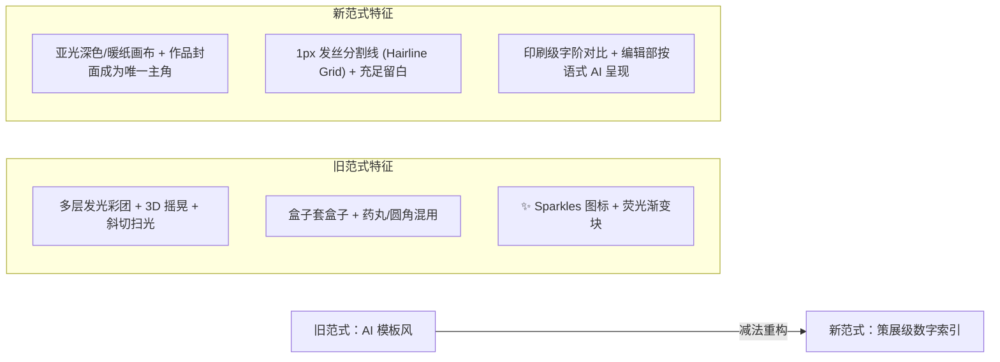

# 前端视觉与交互升级方案：现代、简洁、优雅、去 AI 感

> **文档定位**：ART/RANK 前端体验升级的架构与设计规范蓝图（2026-11-18）
> **核心目标**：在保留全站 12 套主题与核心功能的前提下，洗去「AI 生成模板感（发光雾气 / 玻璃堆叠 / 扫光炫技 / 盒子套盒子）」，建立具有 **Criterion Collection（标准收藏） / Read.cv / Linear / MUBI** 质感的**「策展级个人文化索引（Curatorial Digital Index）」**。

---

## 一、现状诊断：为什么当前界面会产生「AI 感」与繁杂感？

结合 `src/styles/00-base.css` .. `05-modern.css` 及 `src/views/*.tsx` 的源码审计，当前前端并非缺乏设计投入，而是**多轮局部美化叠加后，陷入了典型的「AI 生成式 UI 审美套路」**：

| 序号 | 病灶维度 | 源码取证（现状） | 为什么显得「AI 感重 / 不够优雅」 |
| :--- | :--- | :--- | :--- |
| **1** | **特效堆砌过载**<br>（Over-layered Gimmicks） | `src/styles/05-modern.css:23-49, 100-133`<br>`HomeView.tsx:83-105` | 默认 `modern` 主题在首屏同时叠加了 **8 层视觉特效**：① Three.js 3D 光球 + ② 3 个漂浮高斯模糊彩团（`.md-blob-a/b/c`，`blur(70px)`）+ ③ 鼠标跟随聚光灯（`.md-spot`）+ ④ 斜线噪点（`.md-grain`）+ ⑤ 按钮 `skewX(-18deg)` 斜切扫光 + ⑥ 按钮径向追光 + ⑦ 维度卡 `rotateX/Y` 3D 摇晃 + ⑧ `48px` 荧光外发光（`--m-glow-hover`）。这种「背景彩团 + 毛玻璃 + 扫光 + 3D 倾斜」是 2024–2025 AI 生成 Landing Page 最典型的模板特征，喧宾夺主。 |
| **2** | **同一组件多重人格**<br>（CSS 覆写分裂） | `00-base.css:37` vs `00-base.css:57` vs `05-modern.css:119` vs `05-modern.css:163` | 以首页四大媒介入口 `.medium-item` 为例：在 `00-base.css` 前半段是 **4 列直角印刷网格**，后半段被改成 **`999px` 药丸横条**，到了 `05-modern.css` 又变成 **`150px` 高的圆角 3D 玻璃卡**，到了手机端又突变回 **窄药丸**。同样，`00-base.css:66-77` 对 `.collection-list .collection-row` 连续使用 **18 个 `!important`** 强行改成贴纸卡，破坏了全站统一的列表韵律。 |
| **3** | **AI 符号泛滥**<br>（Sparkles & Glow Panels） | `AiInsightCard.tsx`、`SetupView.tsx`、`CompareView.tsx`、`00-base.css:61` | 凡涉及 AI 解读或 Jev 辅助处，普遍使用 `Sparkles`（✨）图标、独立发光背景框（`.comparison-ai` 蓝青色半透明盒）与「魔法式」文案。真正的文化产品应当把 AI 内化为克制的**「策展按语 / 审稿批注」**，而非闪烁的插件横幅。 |
| **4** | **字体排印缺乏人文温度**<br>（Typography） | `00-base.css:7-8` | `--font-body: "Segoe UI", "Microsoft YaHei"` 与 `--font-display: Bahnschrift, "Segoe UI"` 在中文环境下回退为微软雅黑与工业感极强的 Bahnschrift，缺少现代人文无衬线与编辑部衬线体的冷暖张力；多处列表序号与百分比未开启 `tabular-nums`（等宽数字对齐）。 |
| **5** | **容器嵌套与视觉噪音**<br>（Box-in-Box Noise） | `SourceView.tsx`、`ProfileView.tsx`、`PlazaView.tsx` | 页面内大量使用 `border + background + border-radius + backdrop-filter` 的封闭卡片包裹每一小块区域，外层有框、内层芯片有框、按钮还有框。边框线与半透明玻璃层层相套，挤压了电影海报、书封与专辑封面本身的呼吸空间。 |

---

## 二、美学北极星与四大设计原则

我们将 ART/RANK 的视觉基调定义为 **「Quiet Archival Modernism（静谧档案现代主义）」**——像走进一间灯光克制的私人影院、独立书店或黑胶唱片行：



### 1. 内容即装饰（Content as Chrome）
界面自身退后为**低饱和、高质感的亚光画布**。除关键主行动点（Primary CTA）与当前选中游标外，严禁大面积铺设荧光色光晕。让用户的 Top 1 电影海报、书籍封面、唱片封套成为页面上最鲜艳的视觉锚点。

### 2. 动效做减法：一次只允许一个视觉中心（One Stage Rule）
- **砍掉廉价炫技**：移除按钮与卡片上的 `.before/.after` 斜切扫光（`skewX` sheen）、移除卡片跟随鼠标的 3D `rotateX/rotateY` 摇晃、移除首页多层高饱和漂浮彩团（`.md-blob-a/b/c`）。
- **保留高级物理感**：全站过渡收敛为克制的阻尼曲线 `--ease-out: cubic-bezier(0.22, 1, 0.36, 1)`，交互反馈仅依赖 **`1px` 边框明度微升 + 背景色阶 `2%–4%` 提亮 + 海报 `scale(1.015)` 微缩**。

### 3. 以线代框，以留白代盒子（Hairlines over Boxes）
- 减少封闭圆角框（Card Box）的数量。
- 列表、榜单、维度切换、比较表格优先采用**「开放式发丝线索引（Open Hairline Index）」**：只保留顶/底 `1px solid var(--line)` 分割线，通过 `24px / 32px / 48px` 的留白阶梯划分信息层级。

### 4. 去 AI 符号化（Editorial AI Integration）
- 减少或替换泛滥的 `Sparkles`（✨）图标，改用克制的印刷符号（如 `§`、`/`、`—` 或极简几何图标）。
- 将 AI 品味解读与 Jev 分歧分析重塑为**「策展按语（Curatorial Note）」**：无发光外框，采用左侧 `2px` 垂直引线 + 衬线体正文 + 等宽小号署名。

---

## 三、设计系统（Design System）升级细则

### 3.1 字体排印系统（Typography）

升级 [`src/styles/00-base.css`](file:///e:/mimo/temp/5/film-sort3/src/styles/00-base.css#L7-L8) 中的字体栈，建立**「现代几何无衬线 + 人文衬线 + 精密等宽数字」**的三元结构：

```css
:root {
  /* 正文：优先现代系统无衬线，告别生硬的 Segoe UI / 微软雅黑直出 */
  --font-body: "Inter", -apple-system, BlinkMacSystemFont, "PingFang SC", "HarmonyOS Sans SC", "Noto Sans SC", "Microsoft YaHei UI", sans-serif;

  /* 大标题：兼具现代感与社论气质，英文收紧字距，中文保持字面稳定 */
  --font-display: "Instrument Sans", "Inter", "PingFang SC", "Noto Sans SC", sans-serif;

  /* 人文引用 / 艺术画像导语 / AI 按语：引入经典衬线质感 */
  --font-serif: "Newsreader", "Georgia", "Songti SC", "Noto Serif SC", serif;

  /* 排名序号 / 统计指标 / 年份：强制 tabular-nums 等宽对齐 */
  --font-mono: "JetBrains Mono", "Cascadia Mono", "SFMono-Regular", Consolas, monospace;
}

/* 全局排版微调：数字等宽、标题字距收敛、正文阅读舒适度 */
body {
  -webkit-font-smoothing: antialiased;
  -moz-osx-font-smoothing: grayscale;
  text-rendering: optimizeLegibility;
}

.row-number,
.medium-number,
.comparison-count strong,
.metrics strong {
  font-variant-numeric: tabular-nums;
}
```

### 3.2 色彩与表面层级（Color & Surface Hierarchy）

在默认 `modern` 主题下，降低荧光色 `--accent`（`#d8f86a`）的侵略性——**荧光色只做「点（Dot / Active Line / Primary Pill）」，绝不做「面（Glow Fog / Large Border）」**：

| Token | 现状问题 | 优化方案 |
| :--- | :--- | :--- |
| `--bg` | `#080a0a` 叠了三团高饱和彩雾，底色发脏 | 保持纯净深炭黑 `#090a0a`，仅在 Hero 顶部保留单层 `4%` 极微弱环境漫反射，其余区域全亚光纯底 |
| `--line` | `17%` 在多层盒子里显得杂乱 | 常规分割线收敛为 `12%`（`color-mix(in srgb, var(--text) 12%, transparent)`），悬停态升至 `24%` |
| `--m-glow-hover` | `0 0 48px var(--m-sheen)` 大范围荧光绿外发光 | **移除大范围彩色外发光**，改为细腻的内外双线：`0 0 0 1px color-mix(in srgb, var(--text) 22%, transparent), var(--ev-2)` |
| 媒介色 `--film/book/music/other` | 在卡片边框、背景、文字上同时出现 | 仅作**左侧 2px 状态色标 / 序号点缀 / 微型徽章**，不再把整张卡片染成彩色半透明背景 |

### 3.3 圆角与容器克制规范（Radius & Surface Discipline）

消除同一页面内 `3px`、`6px`、`12px`、`18px`、`999px` 五种圆角混战的局面：
- **作品海报（`.poster`）**：统一小圆角 `var(--r-xs)`（`3px`）或 `4px` + 内嵌 `1px` 微弱高光边（模拟实体画册/黑胶封套的锋利边缘，圆角过大会破坏海报构图）。
- **结构性面板 / 模态框（`.modal-panel`、`.detail-dialog`）**：统一 `var(--r-md)`（`12px`）。
- **按钮与Segmented控件（`.button`、`.segmented`）**：统一 `var(--r-sm)`（`6px`），彻底告别全站满屏 `999px` 大药丸的廉价感（仅微型状态 Tag 保留 `999px`）。

---

## 四、核心视图逐页优化蓝图

### 4.1 首页（[`HomeView.tsx`](file:///e:/mimo/temp/5/film-sort3/src/views/HomeView.tsx) + [`05-modern.css`](file:///e:/mimo/temp/5/film-sort3/src/styles/05-modern.css)）

1. **Hero 区域减负与聚焦**：
   - **背景**：保留 `DeferredOrb`（3D 光球作为唯一的动态艺术装置），**移除** `HeroBackdrop.tsx` 中的三团彩色漂浮模糊球（`.md-blob-a/b/c`）与鼠标聚光灯（`.md-spot`），避免双套背景特效打架。
   - **右上角身份胶囊（`.identity`）**：取消浮在半空的 `.glass-capsule` 毛玻璃药丸，并入顶栏右侧或化为极简的纯文本状态行（`● 已同步 · user@example.com`），让 Hero 舞台干净纯粹。
   - **主标题与导语**：去掉大写英文口号前的装饰横线，副标题采用 `--font-serif` 人文衬线体，形成「无衬线几何报头 `ART/RANK` + 衬线人文副标」的高级杂志感。
2. **四大媒介入口（`.medium-grid`）回归「策展展柜」**：
   - 废除 `00-base.css:57` 的药丸变形与 `05-modern.css:119` 的 3D 摇晃发光卡。
   - 统一为 **4 列无间隙发丝线展柜（1px Hairline Grid）**：
     - 左上：等宽编号 `01`–`04`；
     - 右上：该维度用户当前 Top 1 作品（或精选代表作）的 `2:3` 真实小海报；
     - 左下：媒介名称（电影 / 书籍 / 音乐 / 其他）与已排部数；
     - 交互：悬停时背景微亮 `3%`，箭头平缓右移 `4px`，无 3D 翻转、无斜切扫光。

### 4.2 来源与导入页（[`SourceView.tsx`](file:///e:/mimo/temp/5/film-sort3/src/views/SourceView.tsx)）

1. **清理 `00-base.css:66-77` 的 18 个 `!important` 贴纸卡补丁**：
   - 内置片单/书单列表（`.collection-list`）恢复为**高信息密度的画册式横排索引行**（左：等宽序号 `01` → 中左：3 张叠放的代表作海报缩略图 → 中：榜单标题与简介 → 右：作品数量与进入箭头）。
2. **豆瓣 / 网易云导入区收纳**：
   - 将冗长的「扫码说明 / Cookie 帮助 / 批次进度」收敛为干净的**两步式抽屉或内联折叠区**，默认只展示清爽的输入框与「连接账号」状态徽章，减少满屏说明文字带来的压迫感。

### 4.3 1v1 排序擂台（[`SortingView.tsx`](file:///e:/mimo/temp/5/film-sort3/src/views/SortingView.tsx)）

1. **打造「暗房审片室（Darkroom Duel）」沉浸感**：
   - 对决卡片（`.artwork-card`）去除厚重的双层边框与底部拼接工具栏（`.artwork-card-tools`）。
   - 海报占比提升，作品标题与年份/创作者左对齐排布于海报正下方；次要操作（详情、换封面、暂放）化为卡片角落或底部的幽灵图标按钮（悬停显现，移动端常驻弱化态）。
2. **进度与自适应反馈降噪**：
   - 顶部进度条保持 `2px` 极细线；自适应模式（Adaptive）的置信度与名次区间条融入底部状态栏，避免在两张海报上方堆叠过多技术指标。

### 4.4 我的文化索引（[`ProfileView.tsx`](file:///e:/mimo/temp/5/film-sort3/src/views/ProfileView.tsx)）

1. **「前三名领奖台 + 档案列表」双层结构**：
   - **Top 1–3 展陈区**：每个维度的前 3 名作品以较大尺寸的 `2:3` 海报并列展示（配衬线体个人批注摘录），凸显「核心审美名片」。
   - **Top 4–N 索引表**：采用紧凑的 `1px` 顶线行列表，序号使用等宽字体右对齐，批注以安静的灰色斜体/衬线体跟在作品下方。
2. **右侧操作栏（`.export-tools`）去面板化**：
   - 合并零散的导出、分享、发布广场、AI 解读按钮：主动作保留「导出长图 / 分享画像」，其余低频设置收纳进次级菜单。

### 4.5 AI 解读与比较页（[`AiInsightCard.tsx`](file:///e:/mimo/temp/5/film-sort3/src/components/AiInsightCard.tsx)、[`CompareView.tsx`](file:///e:/mimo/temp/5/film-sort3/src/views/CompareView.tsx)、[`DepthCompareView.tsx`](file:///e:/mimo/temp/5/film-sort3/src/views/DepthCompareView.tsx)）

1. **AI 解读去「对话框/魔法盒」化**：
   - 将 `.comparison-ai` 与 `AiInsightCard` 从彩色半透明发光盒改为**「编辑部按语（Editorial Pull-quote）」**：
   ```css
   .editorial-note {
     border-left: 2px solid var(--accent);
     padding: 4px 0 4px 20px;
     margin: 24px 0;
     background: transparent;
   }
   .editorial-note p {
     font-family: var(--font-serif);
     font-size: 15px;
     line-height: 1.85;
     color: var(--text-2);
   }
   ```
2. **比较页（`/encounter` 与 `/depth`）视觉对齐**：
   - 统一两页的指标大字（`tabular-nums` 等宽无衬线/等宽体，字号 `36px`，去掉红绿蓝三色强行区分，改用统一的 `--text` 主色 + 微小色点标识），让数据可视化像瑞士平面设计（Swiss Grid）一样冷静克制。

---

## 五、CSS 债务清理与工程落地路线图

为确保**零回归**且不一次性击穿现有的视觉测试绊线（`src/ui-fixes.test.ts`、`src/modern-ui.test.ts`、`scripts/ui-contrast.mjs`），建议分 **4 个独立提交阶段（Phase U1–U4）** 渐进落地：

### Phase U1 · 字体排印、圆角收敛与去 `!important`（基础层）
- **改动文件**：`src/styles/00-base.css`、`src/styles/04-tokens-polish.css`
- **动作**：
  1. 升级 `--font-body`、`--font-display`、`--font-serif`、`--font-mono` 字体栈，为所有排名序号、指标、计数器启用 `font-variant-numeric: tabular-nums`。
  2. 移除 `00-base.css:66-77` 中 `.collection-list .collection-row` 的 18 处 `!important`，恢复清爽的横排画册索引行。
  3. 统一 `.medium-item` 在 `00-base.css` 中的两套冲突定义，消除 `999px` 大药丸覆盖。

### Phase U2 · `modern` 默认主题「去 AI 感」减法重塑（核心层）
- **改动文件**：`src/styles/05-modern.css`、`src/views/HomeView.tsx`、`src/components/HeroBackdrop.tsx`、`src/modern-ui.test.ts`
- **动作**：
  1. 简化 `05-modern.css`：移除 `.button.primary:before` 斜切扫光、`.medium-item:after` 斜切流光、`.medium-item` 的 3D `rotateX/Y` 摇晃与 `48px` 荧光外发光。
  2. 收敛 `HeroBackdrop`：将三团高饱和漂浮彩雾降噪为单层极低不透明度（`6%`）的静态/微动环境光，让 `DeferredOrb` 3D 光球成为唯一视觉中心。
  3. 同步更新 `src/modern-ui.test.ts` 中的对应断言，保持 View Transitions、顶栏滚动收缩与 `prefers-reduced-motion` 护栏完好。

### Phase U3 · 组件去 AI 符号化与「编辑部按语」改造（组件层）
- **改动文件**：`src/components/AiInsightCard.tsx`、`src/components/JevDivergenceCard.tsx`、`src/views/CompareView.tsx`、`src/views/ProfileView.tsx`
- **动作**：
  1. 将 AI 品味解读与比较洞察从「彩色发光盒 + ✨ 图标」改造为「左侧引线 + 衬线体按语」样式。
  2. 优化 `ProfileView` 的 Top 3 作品领奖台排版与右侧工具栏层级。

### Phase U4 · 视觉基线重拍与无障碍对比度复核（验收层）
- **改动文件**：`docs/ui-baseline.json`、`docs/ui-contrast.json`
- **动作**：
  1. 运行 `node scripts/ui-contrast.mjs` 确保 12 套主题在全部表面上的对比度均满足 WCAG AA（`--text-3` ≥ 4.5:1）。
  2. 运行 `node scripts/ui-shadows.mjs` 与 `node scripts/ui-audit.mjs` 更新度量档案。
  3. 执行 `npm run gates` 全套门禁并在 `https://sort.logicc.top` 线上实机走查。

---

## 六、设计自检清单（De-AI Checklist）

后续任何前端 PR 合入前，可用以下 6 条标准自检是否回退到了「AI 模板风」：

- [ ] **无多余光团**：同一视口内是否出现了 2 个以上的高斯模糊彩色背景团（`filter: blur(>40px)`）？若是，砍掉。
- [ ] **无斜切扫光**：按钮或卡片悬停时是否有 `skewX` 白色光带横扫而过？若是，改为 `1px` 边框提亮。
- [ ] **无盒子套盒子**：是否在带边框的卡片内部又套了一层带边框和背景色的子卡片？若是，内层改用 `1px` 分割线或纯留白。
- [ ] **无泛滥药丸**：除微型 Tag 外，大尺寸容器或导航块是否使用了 `border-radius: 999px`？若是，收敛回 `6px` / `12px`。
- [ ] **数字严格对齐**：所有排行榜序号、得票数、Kendall τ 百分比是否开启了 `tabular-nums`？
- [ ] **海报永远是主角**：眯起眼睛看页面时，最吸引视线的是用户的电影/书籍/音乐封面，还是界面自身的荧光绿边框？必须是前者。
